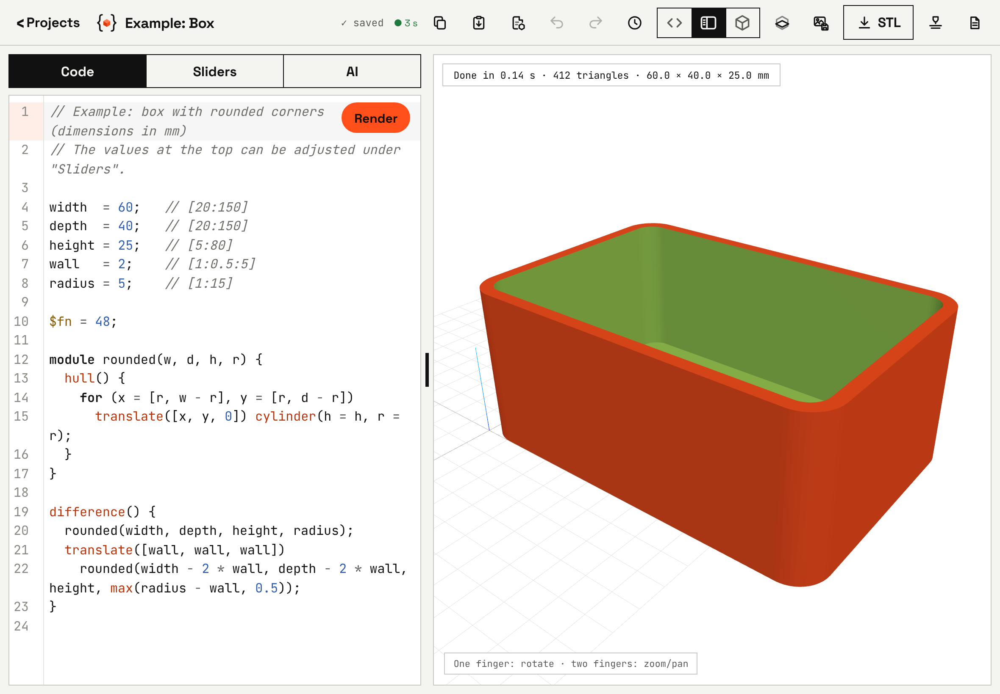
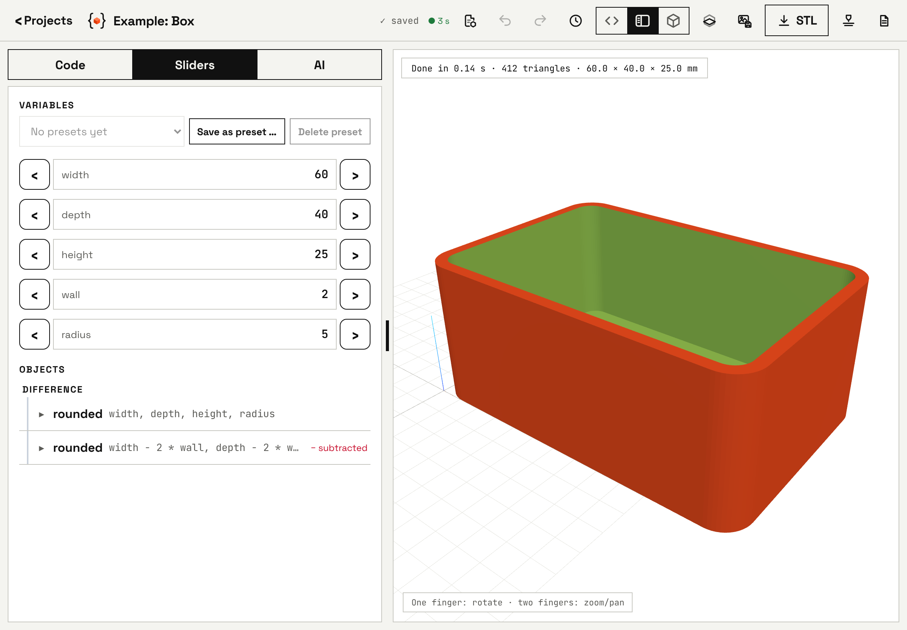
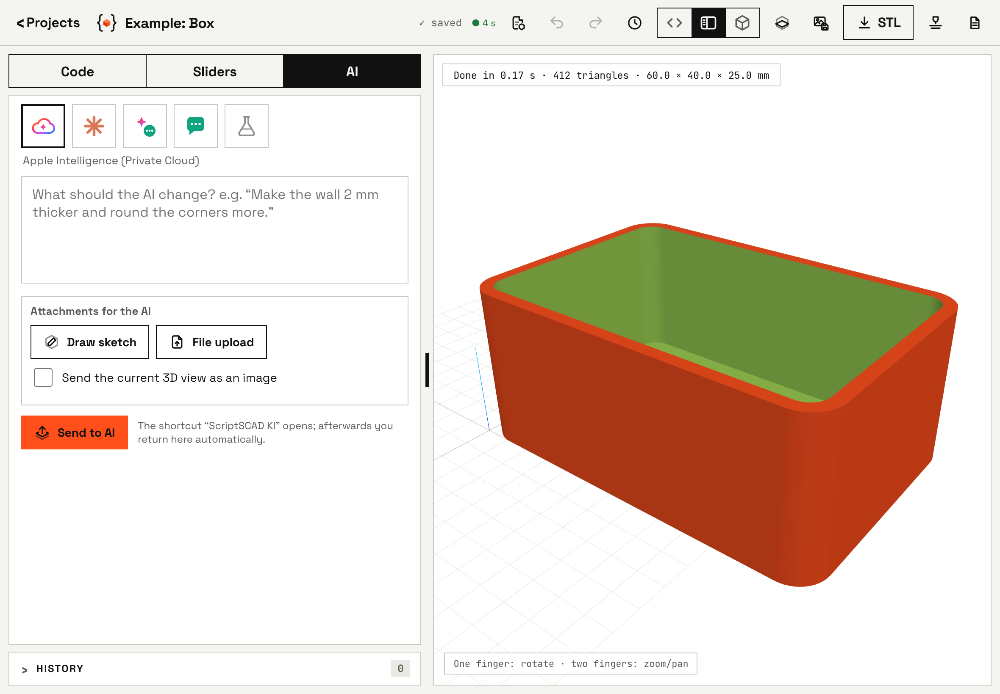
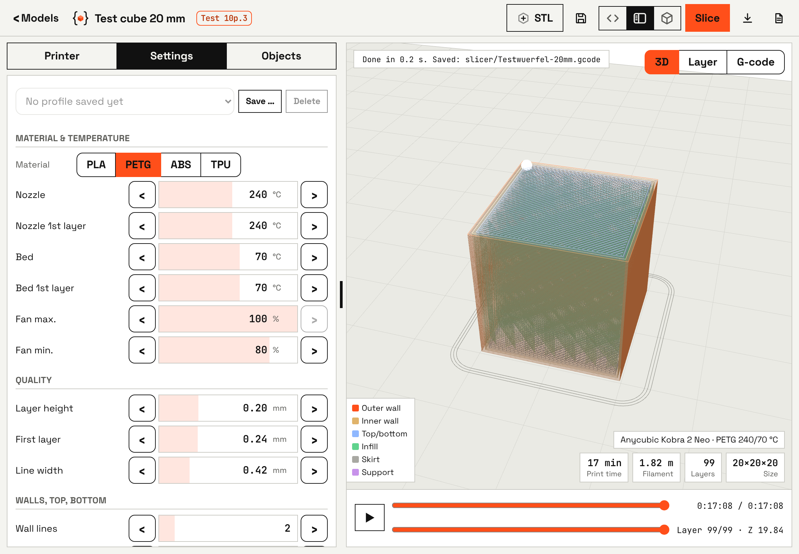

# ScriptSCAD – parametrisches 3D-CAD und Slicer für das iPad

**Konstruiere 3D-druckbare Teile auf dem iPad mit OpenSCAD-Code, Reglern oder in normaler Sprache – und slice sie für deinen Drucker. Alles auf dem Gerät, offline, kostenlos und quelloffen.**

[English version](README.md)

  
   
  ScriptSCAD Studio auf einem iPad Air (Beispielprojekt)

ScriptSCAD besteht aus zwei [Scriptable](https://scriptable.app)-Skripten:

| | |
|---|---|
| **ScriptSCAD Studio** | OpenSCAD-Editor mit 3D-Ansicht, Reglern für jeden Parameter, Objekt-Editor und STL-/3MF-Export. Auf Wunsch ändert eine KI (Apple Intelligence, ChatGPT oder Claude) dein Modell. |
| **ScriptSCAD Slicer** | Macht aus STL-/3MF-/OBJ-Dateien G-Code mit der bewährten CuraEngine – Druckerbibliothek, Profile, 3D-Schichtvorschau, Upload zu OctoPrint/Klipper/PrusaLink. |

## Was ist anders als bei anderen Apps?

- **Echtes OpenSCAD auf dem iPad, komplett offline.** Die offizielle OpenSCAD-Engine läuft lokal als WebAssembly. Kein Server, kein Konto, kein Internet – außer du fragst eine KI.
- **Code, Regler *und* KI am selben Modell.** OpenSCAD schreiben, Regler ziehen, Objekte in 3D antippen und verschieben/drehen/skalieren – oder einfach sagen: *„Mach die Wand 2 mm dicker.“* Jede Änderung bleibt lesbarer `.scad`-Code, der auch in OpenSCAD am Mac oder PC funktioniert.
- **Deine eigene KI – ohne API-Schlüssel.** Die KI-Anfrage läuft über einen Apple-Kurzbefehl mit den KI-Apps, die du ohnehin nutzt (Apple Intelligence, ChatGPT-App, Claude-App). Es wird nur etwas gesendet, wenn du *An KI senden* antippst.
- **Von der Idee zum G-Code ohne Computer.** Die meisten iPad-CAD-Apps hören bei der STL auf und brauchen einen Slicer am Computer oder in der Cloud. ScriptSCAD Slicer slict direkt auf dem iPad.
- **Deine Dateien bleiben deine.** Alles liegt als normale Dateien in *iCloud Drive › Scriptable › ScriptSCAD* – leicht zu sichern, zu teilen und woanders zu öffnen.
- **Frei und quelloffen** (GPL-3.0). Kein Abo, keine Werbung, kein Tracking.

## Funktionen

**ScriptSCAD Studio**
- Code-Editor mit Syntax-Hervorhebung, Autovervollständigung (OpenSCAD, eigene Module, BOSL2/MCAD) und Tastenkürzeln für die Hardware-Tastatur
- Schnelle 3D-Ansicht (drehen/zoomen mit den Fingern), Schnittansicht, Farben aus `color()`
- **Regler** für alle Variablen oben in der Datei, mit Vorlagen; **Objekt-Editor** für Lage, Drehung, Größe, Fasen und Abrundungen – Objekt in 3D antippen zum Auswählen
- Projekte mit Versionsverlauf (rückgängig, vergleichen, wiederherstellen) und Papierkorb
- **KI-Reiter:** Änderung beschreiben, Skizze, Foto, Dateien oder die aktuelle 3D-Ansicht mitgeben; den Vorschlag vor dem Übernehmen nebeneinander vergleichen. Fehler beim Rendern lassen sich von der KI reparieren
- Eigene Bibliothek für Gewinde, Muttern, Schrauben, Fasen und Abrundungen, dazu **BOSL2**, **MCAD** und **NopSCADlib**; Schriften für `text()`
- STL/OBJ/3MF/SVG/DXF als Teil importieren (`import()`) – z. B. um einem heruntergeladenen Modell eine Bohrung hinzuzufügen
- Export als **STL**, **3MF mit Farben** oder **eine STL je Körper**; *Im Slicer öffnen* mit einem Tipp
- Deutsch und Englisch, hell und dunkel, iPad und iPhone

  
  

**ScriptSCAD Slicer**
- **CuraEngine** (die Slicing-Engine von UltiMaker Cura) läuft lokal
- Rund 300 Drucker aus der Cura-Bibliothek plus eigene Drucker mit Start-/End-G-Code
- Einstellungen aus G-Code von Cura, PrusaSlicer/SuperSlicer, Bambu Studio/OrcaSlicer oder Simplify3D übernehmen
- Einfache Einstellungen (Material, Temperaturen, Schichthöhe, Wände, Füllung, Stützen, Haftung …) plus Experten-Bereich (Naht, Bügeln, Vasen-Modus, Füllmuster); als Profile speichern
- Mit leerer Druckplatte oder einem Modell beginnen; mehrere Objekte pro Druckplatte: verschieben, drehen, skalieren, auf eine Fläche legen, anordnen; automatische Netz-Reparatur
- Vorschau in 3D, je Schicht und als G-Code, mit Zeitregler und Abspielen; Druckzeit und Filamentverbrauch
- G-Code teilen/speichern oder an **OctoPrint**, **Klipper (Moonraker)** oder **PrusaLink** senden

  

---

## Das brauchst du

| Du brauchst | Wozu |
|---|---|
| Ein **iPad** (empfohlen) oder iPhone | Entwickelt und getestet auf einem iPad Air (M2). |
| Die kostenlose App **Scriptable** | Sie führt beide Skripte aus. Programmieren musst du **nicht** können. |
| **iCloud Drive** eingeschaltet | Dort liegen die Skripte und Dateien von Scriptable. |
| Optional: eine KI | **Apple Intelligence** (unterstütztes Gerät), die **ChatGPT-App** oder die **Claude-App** – plus der mitgelieferte Kurzbefehl. Ohne KI funktioniert alles andere offline. |
| Optional: einen 3D-Drucker | Für den Slicer. |

---

## Installation (etwa 5 Minuten)

### 1. Scriptable installieren
[**→ Scriptable im App Store (kostenlos)**](https://apps.apple.com/app/scriptable/id1405459188)
Die App danach einmal öffnen, damit ihr Ordner in iCloud Drive entsteht.

### 2. ScriptSCAD laden
1. Auf dem iPad das [**neueste Release**](../../releases/latest) öffnen und **`ScriptSCAD-<Version>.zip`** antippen → **Laden**.
2. Die App **Dateien** → **Downloads** öffnen und die ZIP antippen. Es entsteht ein Ordner `ScriptSCAD-<Version>`.

### 3. Dateien nach Scriptable bewegen
1. Den Ordner `ScriptSCAD-<Version>` öffnen.
2. **`ScriptSCAD Studio.js`**, **`ScriptSCAD Slicer.js`** und den Ordner **`ScriptSCAD`** auswählen (oben rechts **Auswählen**).
3. **Bewegen** antippen und **iCloud Drive › Scriptable** wählen.
4. Empfohlen für die Offline-Nutzung: Ordner **Scriptable** lange drücken → **Geladen lassen**.

✅ **ScriptSCAD Studio** und **ScriptSCAD Slicer** erscheinen jetzt in Scriptable.

### 4. Starten
In Scriptable **ScriptSCAD Studio** antippen. Der erste Start dauert ein paar Sekunden, weil OpenSCAD lädt. *Beispiel: Kiste* öffnen, einen Regler ziehen – fertig.
Den Slicer startest du in Scriptable (**ScriptSCAD Slicer**) oder in Studio mit **Im Slicer öffnen**.

### 5. Optional: KI-Kurzbefehl
1. **`ScriptSCAD KI.shortcut`** antippen (im Release-Ordner oder [hier](shortcut/ScriptSCAD%20KI.shortcut)) → **Kurzbefehl hinzufügen**. Der Name muss genau **ScriptSCAD KI** bleiben.
2. In Studio den Reiter **KI** öffnen, eine KI wählen und **An KI senden** antippen. Beim ersten Mal fragt iOS nach Zugriff auf den Scriptable-Ordner und die KI-App → **Erlauben**.

| KI | Hinweis |
|---|---|
| Apple Intelligence (Private Cloud) | Braucht ein Gerät mit Apple Intelligence. |
| ChatGPT über Apple Intelligence | Braucht Apple Intelligence mit ChatGPT-Erweiterung. |
| ChatGPT-App | Braucht die ChatGPT-App und ein Konto. |
| Claude-App | Braucht die Claude-App. Sie gibt lange Antworten nicht an Kurzbefehle zurück; du kopierst die Antwort und Studio übernimmt sie aus der Zwischenablage (Studio zeigt, wie). |

> 💡 **Tipp:** Skripte auf den Home-Bildschirm legen: in der Kurzbefehle-App einen Kurzbefehl mit der Aktion *Scriptable › Skript ausführen* anlegen und *Zum Home-Bildschirm* wählen.

---

## Updates

In Studio: **Einstellungen › Nach Updates suchen**. Gibt es eine neue Version, lädt Studio sie nach *ScriptSCAD/updates* (nur wenn du *Herunterladen* antippst) und zeigt die drei Schritte: entpacken, den Ordner **`ScriptSCAD/app`** ersetzen, Scriptable neu starten.
Deine Projekte, Einstellungen, Drucker und Profile bleiben unberührt – sie liegen außerhalb von `app`.

---

## Probleme?

| Was du siehst | Lösung |
|---|---|
| „Datei fehlt … app/main.js“ | Der Ordner `ScriptSCAD` ist unvollständig oder liegt nicht direkt in *iCloud Drive › Scriptable*. Noch einmal kopieren (Schritt 3). |
| Erster Start langsam oder hängt | Dateien werden evtl. noch aus iCloud geladen. Scriptable-Ordner auf **Geladen lassen** stellen und neu starten. |
| Die KI tut nichts | Prüfen, ob der Kurzbefehl genau **ScriptSCAD KI** heißt und seine Zugriffsfragen erlaubt wurden. Die KI *Test* prüft den Ablauf ohne echte KI. |
| Die KI-Antwort lässt sich nicht übernehmen | *Von KI reparieren lassen* antippen oder den Wunsch anders formulieren. Manche KIs schreiben OpenSCAD zuverlässiger als andere – eine andere probieren. |
| `text()` sieht falsch aus | Der Ordner `ScriptSCAD/fonts` fehlt. |
| Etwas anderes | Studio und Slicer haben ein **Protokoll** (Blatt-Symbol oben rechts). [Issue anlegen](../../issues) und Protokoll oder Bildschirmfoto anhängen. |

---

## Gut zu wissen

- **Vor dem Druck prüfen.** Der Slicer ist neu. Schau dir die Schichtvorschau an und bleib bei den ersten Drucken in der Nähe – besonders mit einem neuen Drucker oder Profil.
- Dasselbe Projekt nicht gleichzeitig auf zwei Geräten bearbeiten (iCloud-Konflikte).
- Nur die KI-Anfrage braucht Internet. Welche Daten an welchen KI-Anbieter gehen, regeln dessen App und Bedingungen.

## Datenschutz

Dieses Projekt hat keine Server und kein Tracking. Modelle, Einstellungen und Protokolle sind Dateien in deinem iCloud Drive.
Nur wenn du **An KI senden** antippst, wird der Prompt (dein Wunsch, der aktuelle Code und die gewählten Anhänge) über den Kurzbefehl an die gewählte KI übergeben.
Die optionale Update-Prüfung liest eine kleine Datei von GitHub – nur, wenn du den Knopf antippst.
Der Button **Spenden** öffnet nur die Ko-fi-Seite in Safari; die App selbst lädt nichts von Ko-fi.

## ScriptSCAD unterstützen

ScriptSCAD ist kostenlos und bleibt es – kein Abo, keine Werbung. Wenn es dir Zeit spart, freue ich mich über eine kleine Spende in beliebiger Höhe (Apple Pay, PayPal oder Karte):

Auch in beiden Apps möglich: **Einstellungen › ScriptSCAD unterstützen**.

## Lizenz

ScriptSCAD Studio, ScriptSCAD Slicer und der Kurzbefehl sind freie Software unter der **[GNU General Public License v3.0 oder neuer](LICENSE)**. © 2026 Anton Angierski. Das Programm wird **ohne Gewährleistung** bereitgestellt.

Enthaltene Open-Source-Bestandteile (vollständige Texte in [`Scriptable/ScriptSCAD/licenses`](Scriptable/ScriptSCAD/licenses), außerdem in beiden Apps unter **Einstellungen › Über & Lizenzen**):

| Bestandteil | Lizenz | Verwendet in |
|---|---|---|
| [OpenSCAD](https://github.com/openscad/openscad) 2025.03.25 (WebAssembly-Build über [openscad-playground](https://github.com/openscad/openscad-playground)) | GPL-2.0-or-later (enthält CGAL, GPL-3.0-or-later) | Studio |
| [CuraEngine](https://github.com/Ultimaker/CuraEngine) 4.6.1 (WebAssembly-Build über [cura-wasm](https://github.com/Cloud-CNC/cura-wasm)) | AGPL-3.0-or-later (Lader MIT) | Slicer |
| Druckerdefinitionen aus [Ultimaker Cura](https://github.com/Ultimaker/Cura) (über [cura-wasm-definitions](https://github.com/Cloud-CNC/cura-wasm-definitions)) | LGPL-3.0-or-later | Slicer |
| [three.js](https://github.com/mrdoob/three.js) r170 | MIT | beide |
| [CodeMirror 6](https://codemirror.net) | MIT | Studio |
| [BOSL2](https://github.com/BelfrySCAD/BOSL2) | BSD-2-Clause | Studio |
| [MCAD](https://github.com/openscad/MCAD) | LGPL-2.1 | Studio |
| [NopSCADlib](https://github.com/nophead/NopSCADlib) | GPL-3.0 | Studio |
| Schriften Liberation, Noto Sans, Space Grotesk, JetBrains Mono | SIL OFL 1.1 | beide |

Quellen und Bauskripte aller erzeugten Dateien liegen in [`source/`](source). Details: [docs/TECHNICAL.md](docs/TECHNICAL.md#licenses-and-source-code) (englisch).

Unabhängiges Projekt, nicht verbunden mit dem OpenSCAD-Projekt, UltiMaker, Apple, OpenAI, Anthropic oder dem Entwickler von Scriptable. Alle Marken gehören ihren Inhabern.

---

**Für Entwickler:** Zusammenspiel von Skripten, WebView, OpenSCAD/CuraEngine als WebAssembly und KI-Kurzbefehl, Ordneraufbau und Neubau aus den Quellen: [**docs/TECHNICAL.md**](docs/TECHNICAL.md)
