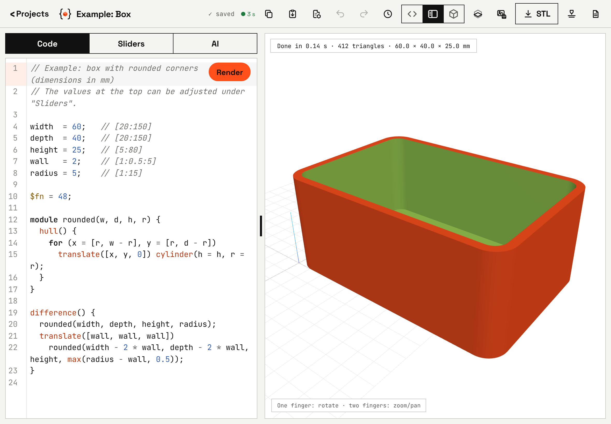
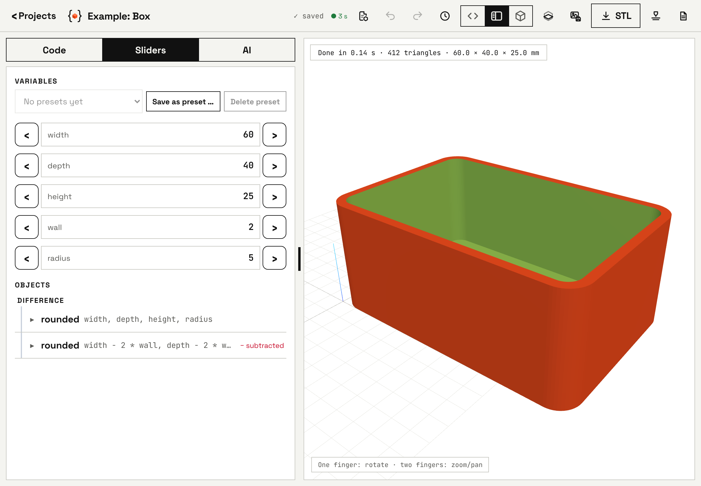
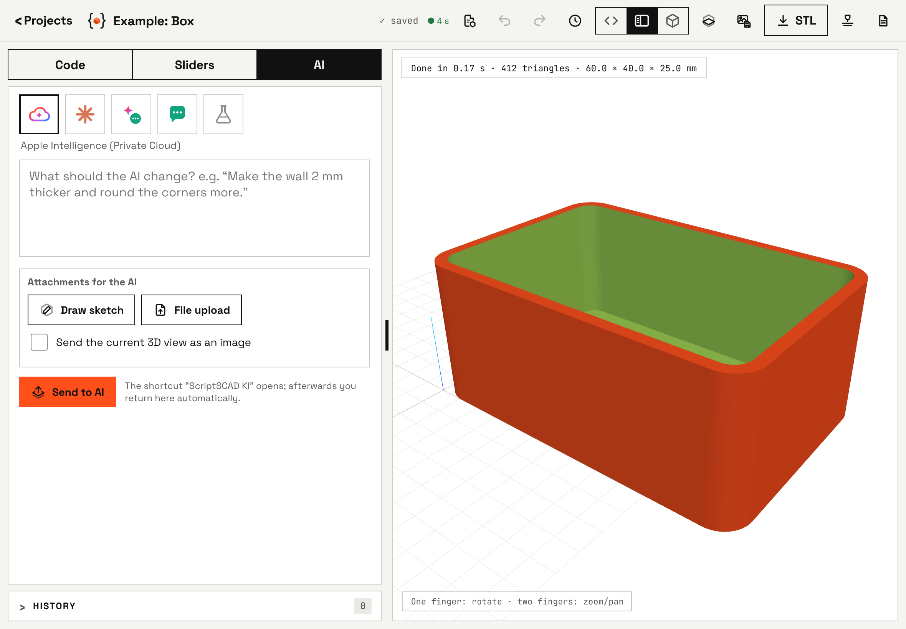
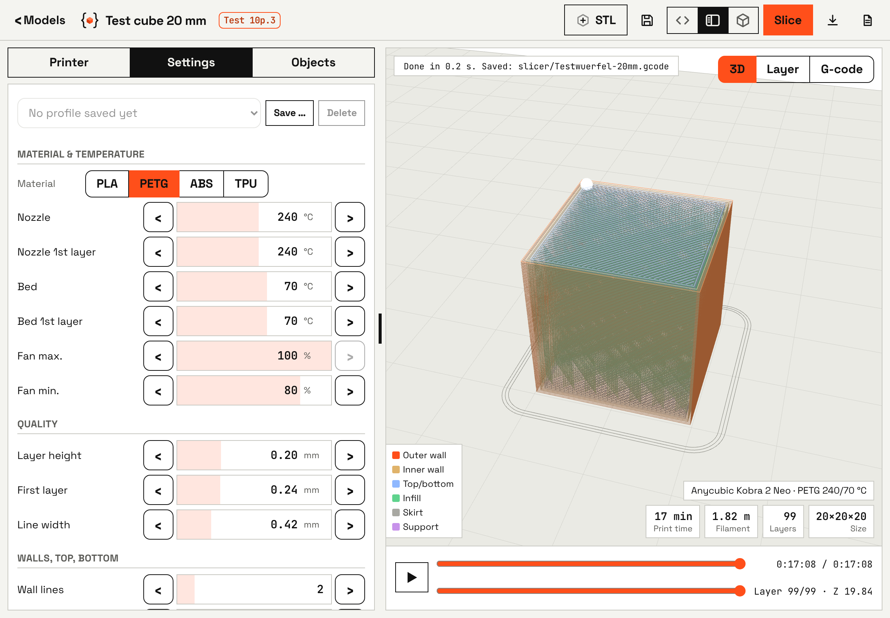

# ScriptSCAD – parametric 3D CAD and slicer for iPad

**Design 3D-printable parts on your iPad with OpenSCAD code, sliders or plain language – and slice them for your printer, all on the device, offline, free and open source.**

[Deutsche Version](README.de.md)

  
   
  ScriptSCAD Studio on an iPad Air (example project)

ScriptSCAD is a suite of two [Scriptable](https://scriptable.app) scripts:

| | |
|---|---|
| **ScriptSCAD Studio** | OpenSCAD editor with 3D view, sliders for every parameter, object editor and STL/3MF export. Optionally lets an AI (Apple Intelligence, ChatGPT or Claude) change your model. |
| **ScriptSCAD Slicer** | Turns STL/3MF/OBJ files into G-code with the proven CuraEngine – printer library, profiles, 3D layer preview, upload to OctoPrint/Klipper/PrusaLink. |

## What makes it different

- **Real OpenSCAD on the iPad, completely offline.** The official OpenSCAD engine runs locally as WebAssembly. No server, no account, no internet – except when you ask an AI.
- **Code, sliders *and* AI on the same model.** Write OpenSCAD, drag sliders, tap objects in 3D to move/rotate/resize them – or just say *"make the wall 2 mm thicker"*. Every change stays readable `.scad` code that also works in OpenSCAD on a Mac or PC.
- **Bring your own AI – no API key.** The AI request runs through an Apple Shortcut with the AI apps you already use (Apple Intelligence, ChatGPT app, Claude app). Nothing is sent anywhere unless you tap *Send to AI*.
- **From idea to G-code without a computer.** Most iPad CAD apps stop at the STL and need a desktop or cloud slicer. ScriptSCAD Slicer slices on the iPad itself.
- **Your files stay yours.** Everything lives as normal files in *iCloud Drive › Scriptable › ScriptSCAD* – easy to back up, share and open elsewhere.
- **Free and open source** (GPL-3.0). No subscription, no ads, no tracking.

## Features

**ScriptSCAD Studio**
- Code editor with syntax highlighting, autocompletion (OpenSCAD, your own modules, BOSL2/MCAD) and hardware-keyboard shortcuts
- Fast 3D view (rotate/zoom with your fingers), cross-section view, colors from `color()`
- **Sliders** for all variables at the top of the file, with presets; **object editor** for position, rotation, size, chamfers and fillets – tap an object in 3D to select it
- Projects with version history (undo, compare, restore) and a trash
- **AI tab:** describe the change, add a sketch, a photo, files or the current 3D view; review the proposal side by side before you apply it. Rendering errors can be sent back to the AI for repair
- Built-in library for threads, nuts, screws, chamfers and fillets, plus **BOSL2**, **MCAD** and **NopSCADlib**; fonts for `text()`
- Import STL/OBJ/3MF/SVG/DXF as parts (`import()`) – e.g. to add a hole to a downloaded model
- Export **STL**, **3MF with colors** or **one STL per body**; *Open in Slicer* with one tap
- English and German, light and dark mode, iPad and iPhone

  
  

**ScriptSCAD Slicer**
- **CuraEngine** (the slicing engine of UltiMaker Cura) running locally
- About 300 printers from the Cura library plus your own printers with start/end G-code
- Take over settings from G-code of Cura, PrusaSlicer/SuperSlicer, Bambu Studio/OrcaSlicer or Simplify3D
- Simple settings (material, temperatures, layer height, walls, infill, supports, adhesion …) plus an expert section (seam, ironing, vase mode, infill pattern); save them as profiles
- Start from an empty print plate or a model; several objects per plate: move, rotate, scale, lay on a face, arrange; automatic mesh repair
- Preview in 3D, by layer and as G-code, with a time slider and playback; print time and filament use
- Share/save G-code or send it to **OctoPrint**, **Klipper (Moonraker)** or **PrusaLink**

  

---

## Before you start

| You need | Why |
|---|---|
| An **iPad** (recommended) or iPhone | Developed and tested on an iPad Air (M2). |
| The free app **Scriptable** | It runs both scripts. You do **not** need to know how to code. |
| **iCloud Drive** turned on | Scriptable keeps its scripts and files there. |
| Optional: an AI | **Apple Intelligence** (supported device), the **ChatGPT app** or the **Claude app** – plus the included shortcut. Without AI, everything else works offline. |
| Optional: a 3D printer | For the slicer. |

---

## Installation (about 5 minutes)

### 1. Install Scriptable
[**→ Scriptable on the App Store (free)**](https://apps.apple.com/app/scriptable/id1405459188)
Open the app once afterwards, so its folder in iCloud Drive is created.

### 2. Download ScriptSCAD
1. On your iPad, open the [**latest release**](../../releases/latest) and tap **`ScriptSCAD-<version>.zip`** → **Download**.
2. Open the **Files** app → **Downloads** and tap the ZIP. A folder `ScriptSCAD-<version>` appears.

### 3. Move the files into Scriptable
1. Open the folder `ScriptSCAD-<version>`.
2. Select **`ScriptSCAD Studio.js`**, **`ScriptSCAD Slicer.js`** and the folder **`ScriptSCAD`** (tap **Select** at the top right).
3. Tap **Move** and choose **iCloud Drive › Scriptable**.
4. Recommended for offline use: long-press the **Scriptable** folder → **Keep Downloaded**.

✅ **ScriptSCAD Studio** and **ScriptSCAD Slicer** now appear in Scriptable.

### 4. Start
Tap **ScriptSCAD Studio** in Scriptable. The first start takes a few seconds while OpenSCAD loads. Open *Example: Box*, drag a slider – done.
The slicer starts from Scriptable (**ScriptSCAD Slicer**) or from Studio with **Open in Slicer**.

### 5. Optional: AI shortcut
1. Tap **`ScriptSCAD KI.shortcut`** (in the release folder or [here](shortcut/ScriptSCAD%20KI.shortcut)) → **Add Shortcut**. Keep the name **ScriptSCAD KI** exactly.
2. In Studio, open the **AI** tab, choose an AI and tap **Send to AI**. The first time, iOS asks for access to the Scriptable folder and the AI app → **Allow**.

| AI | Notes |
|---|---|
| Apple Intelligence (Private Cloud) | Needs a device with Apple Intelligence. |
| ChatGPT via Apple Intelligence | Needs Apple Intelligence with the ChatGPT extension. |
| ChatGPT app | Needs the ChatGPT app and an account. |
| Claude app | Needs the Claude app. The app does not hand long answers back to shortcuts, so you copy the answer and Studio picks it up from the clipboard (Studio shows how). |

> 💡 **Tip:** Add the scripts to your home screen: in the Shortcuts app, create a shortcut with the action *Scriptable › Run Script* and choose *Add to Home Screen*.

---

## Updates

In Studio: **Settings › Check for updates**. If there is a new version, Studio downloads it to *ScriptSCAD/updates* (only when you tap *Download*) and shows the three steps: unzip, replace the folder **`ScriptSCAD/app`**, restart Scriptable.
Your projects, settings, printers and profiles are never touched – they live outside `app`.

---

## Problems?

| What you see | Solution |
|---|---|
| "File missing … app/main.js" | The folder `ScriptSCAD` is incomplete or not directly in *iCloud Drive › Scriptable*. Copy it again (step 3). |
| First start is slow or hangs | Files may still be downloading from iCloud. Set the Scriptable folder to **Keep Downloaded** and start again. |
| The AI does nothing | Check that the shortcut is named exactly **ScriptSCAD KI** and that you allowed its access requests. Try the *Test* agent: it checks the workflow without an AI. |
| The AI answer cannot be applied | Tap *Let AI repair it* or rephrase the request. Some AIs write OpenSCAD more reliably than others – try another one. |
| `text()` looks wrong | The folder `ScriptSCAD/fonts` is missing. |
| Something else | Studio and Slicer have a **log** (page icon at the top right). [Open an issue](../../issues) and attach it, or a screenshot. |

---

## Good to know

- **Check before you print.** The slicer is new. Look at the layer preview and stay near the printer for your first prints – especially with a printer or profile you have not used before.
- Do not edit the same project on two devices at the same time (iCloud sync conflicts).
- The AI request is the only part that needs the internet. Which data goes to which AI provider is decided by that provider's app and terms.

## Privacy

There are no servers and no tracking in this project. Models, settings and logs are files in your iCloud Drive.
Only when you tap **Send to AI** is the prompt (your request, the current code and the attachments you chose) handed to the AI you selected, via the shortcut.
The optional update check reads one small file from GitHub, only when you tap the button.
The **Donate** button only opens the Ko-fi page in Safari; the app itself loads nothing from Ko-fi.

## Support ScriptSCAD

ScriptSCAD is free and will stay free – no subscription, no ads. If it saves you time, I'm happy about a small donation of any amount (Apple Pay, PayPal or card):

You can also donate from both apps: **Settings › Support ScriptSCAD**.

## License

ScriptSCAD Studio, ScriptSCAD Slicer and the shortcut are free software under the **[GNU General Public License v3.0 or later](LICENSE)**. © 2026 Anton Angierski. This program comes with **no warranty**.

ScriptSCAD includes these open source components (full texts in [`Scriptable/ScriptSCAD/licenses`](Scriptable/ScriptSCAD/licenses), also shown in both apps under **Settings › About & licenses**):

| Component | License | Used in |
|---|---|---|
| [OpenSCAD](https://github.com/openscad/openscad) 2025.03.25 (WebAssembly build via [openscad-playground](https://github.com/openscad/openscad-playground)) | GPL-2.0-or-later (contains CGAL, GPL-3.0-or-later) | Studio |
| [CuraEngine](https://github.com/Ultimaker/CuraEngine) 4.6.1 (WebAssembly build via [cura-wasm](https://github.com/Cloud-CNC/cura-wasm)) | AGPL-3.0-or-later (loader MIT) | Slicer |
| Printer definitions from [Ultimaker Cura](https://github.com/Ultimaker/Cura) (via [cura-wasm-definitions](https://github.com/Cloud-CNC/cura-wasm-definitions)) | LGPL-3.0-or-later | Slicer |
| [three.js](https://github.com/mrdoob/three.js) r170 | MIT | both |
| [CodeMirror 6](https://codemirror.net) | MIT | Studio |
| [BOSL2](https://github.com/BelfrySCAD/BOSL2) | BSD-2-Clause | Studio |
| [MCAD](https://github.com/openscad/MCAD) | LGPL-2.1 | Studio |
| [NopSCADlib](https://github.com/nophead/NopSCADlib) | GPL-3.0 | Studio |
| Liberation, Noto Sans, Space Grotesk, JetBrains Mono fonts | SIL OFL 1.1 | both |

The sources and build scripts for all generated files are in [`source/`](source). Details: [docs/TECHNICAL.md](docs/TECHNICAL.md#licenses-and-source-code).

This is an independent project, not affiliated with or endorsed by the OpenSCAD project, UltiMaker, Apple, OpenAI, Anthropic or the developer of Scriptable. All trademarks belong to their owners.

---

**For developers:** how the scripts, the WebView, OpenSCAD/CuraEngine as WebAssembly and the AI shortcut work together, the file layout and how to rebuild everything from source: [**docs/TECHNICAL.md**](docs/TECHNICAL.md)
